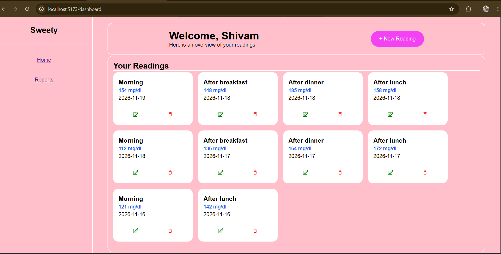
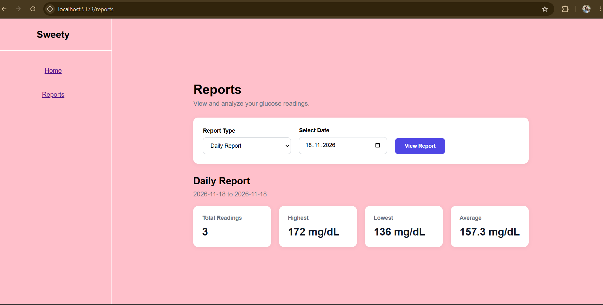
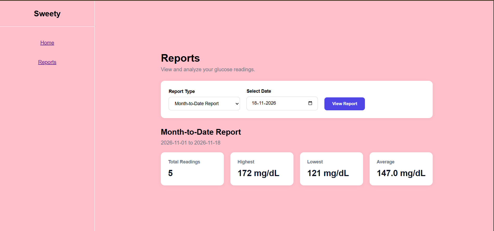
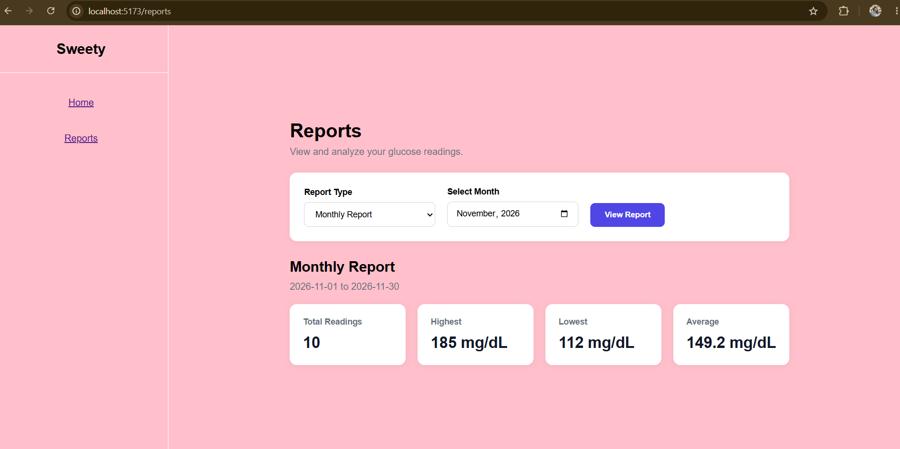

# Sweety – Blood Glucose Tracker

Sweety is a full-stack web application designed to help users record, manage, and monitor their blood glucose readings. It provides a simple dashboard for tracking daily readings and a reports section for reviewing glucose history and understanding reading trends.

## Features

- **User Authentication** – Secure registration and login using password hashing.
- **protect routes** - Protect routes from unotherized access
- **Personalized Dashboard** – View your glucose readings in one place.
- **Reading Management** – Add, view, update and delete blood glucose readings.
- **Multiple Time Slots** – Track readings for:
  - Morning (Fasting)
  - After Breakfast
  - After Lunch
  - After Dinner
- **Input Validation** – Validates readings, dates, and time slots.
- **Duplicate Prevention** – Prevents multiple readings for the same time slot on a particular date.
- **Reports** – View daily, month-to-date and monthly glucose summaries.
- **Statistics** – Calculate average, highest, lowest, and total readings according to report type.
- **User Data Isolation** – Each user can access only their own readings.

## Tech Stack

### Frontend
- React.js
- JavaScript
- CSS
- React Router
- React-icons

### Backend
- Node.js
- Express.js
- REST API

### Database
- PostgreSQL

### Authentication & Security
- bcrypt
- JWT-based authentication

## Installation & Setup

### 1. Clone the repository

```bash
git clone https://github.com/ShivamKumar223/Sweety-Blood-Glucose-Tracker.git
```
### 2. Database Setup

- Install PostgreSQL.
- Create a database for Sweety.
- Configure the database connection in your environment variables.
- Execute the database schema/SQL setup script to create the required tables.

### 3. Backend Setup

Navigate to the backend directory:

```bash
cd server
npm install
```

Create a `.env` file in the server directory using `.env.example` as a reference.

Configure the required environment variables:

```env
PORT=5000

DB_USER=<your_postgreSQL_user_name>
DB_HOST=localhost
DB_NAME=<database_name>
DB_PASSWORD=<your_postgreSQL_password>
DB_PORT=<your_postgreSQL_server_PORT_number>

NODE_ENV=development

JWT_SECRET=<jwt_secret_key>
```

Start the backend server:

```bash
node server.js
```


### 4. Frontend Setup

Open another terminal:

```bash
cd client
npm install
npm run dev
```

Open the local URL provided by Vite in your browser.

## How It Works

1. A user registers and logs into the application.
2. The user records their blood glucose reading by selecting a date, time slot, and reading value.
3. The backend validates the input and stores the reading in PostgreSQL.
4. The dashboard displays the user's recorded readings.
5. The Reports section provides daily, month-to-date, and monthly summaries of the recorded data.

## Validation & Constraints

- Glucose readings must be within the permitted range of 40–600 mg/dL.
- Reading values must be whole numbers.
- Future dates are not allowed.
- A maximum of one reading is allowed per time slot per day for each user.
- Each user can access and manage only their own readings.

## Reports

The reporting module provides:

- Daily readings
- Monthly readings
- Current month summary
- Previous month summary
- Average glucose reading
- Highest reading
- Lowest reading
- Total number of readings

## Screenshots

<!-- Dashboard -->


<!-- Remorts -->





## Assumptions

- Glucose readings are entered manually by users.
- Readings are measured in mg/dL.
- Four predefined daily time slots are used for tracking.
- A user can record one reading per time slot per day.
- The application is intended for tracking and informational purposes and is not a substitute for professional medical advice.

## Future Improvements

- Interactive glucose trend charts.
- Export reports to PDF.
- Reminders for recording glucose readings.
- Improved mobile responsive UI.
- Integration with glucose-monitoring devices.

## Author

**Shivam Yadav**

Full Stack Developer

GitHub: https://github.com/ShivamKumar223

Portfolio: https://shivam-fullstack-developer.netlify.app/


---

## Note

This project is fully functional. If you encounter any issues or have questions regarding the project, feel free to contact me. I'll be happy to help you.

**Contact (WhatsApp):** 7366865889